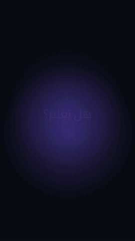
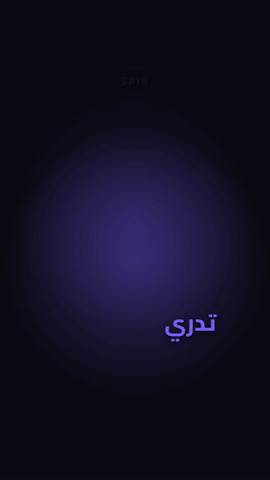

# remotion-arabic-reel



قالب Reel عربي عمودي بحركات نصوص (Kinetic Typography)، مبني بالكود عبر [Remotion](https://www.remotion.dev).
تعدّل النصوص والألوان، فيتولد الفيديو تلقائياً، ويتغير طوله حسب عدد المشاهد.

| الحقل | القيمة |
|---|---|
| النوع | قالب فيديو كامل |
| البرنامج | Remotion 4 (React + TypeScript) |
| المقاس | 1080x1920 (9:16) |
| المدة | ثانيتان لكل مشهد + ثانيتان للخاتمة (افتراضياً 8 ث) |
| FPS | 30 |
| الهوية | من brand kit الشركة (ألوان، خط، شعار) |
| الترخيص | خاص |
| الوسوم | `reel` `arabic` `kinetic-typography` `remotion` |

## التشغيل
المتطلبات: Node.js 18 أو أحدث.

```bash
npm install
npm run studio     # يفتح محرر Remotion في المتصفح للمعاينة والتعديل المباشر
npm run render     # يصدّر الفيديو إلى out/reel.mp4
npm run still      # صورة معاينة من الإطار 45
```

## التخصيص
اختر الشركة بـ `brandId`، فتُطبّق ألوانها وخطها وشعارها والدعوة للإجراء الخاصة بها تلقائياً من
`03-design-assets/brand-kits/<id>/brand.json`:

```json
{
  "brandId": "1r-partners",
  "scenes": [
    { "text": "شريكك في", "accent": "النمو" },
    { "text": "من المشاهدين يقررون", "accent": "في أول ٣ ثوانٍ" }
  ],
  "cta": "اختياري: يتجاوز الدعوة الافتراضية للشركة"
}
```

```bash
npx remotion render ArabicReel out/promo.mp4 --props=props.json
```

- إضافة شركة جديدة: راجع `03-design-assets/brand-kits/README.md` ثم سجّلها في `src/brands.ts`.
- الخطوط المدعومة (`src/fonts.ts`): Cairo، Tajawal، Almarai، IBM Plex Sans Arabic، Readex Pro.
- لتغيير مدة المشهد: `SCENE_FRAMES` في `src/ArabicReel.tsx` (30 إطار = ثانية).
- لإضافة موسيقى: ضع الملف في `public/` واستخدم `<Audio src={staticFile("music.mp3")} />` داخل `ArabicReel`.

## فيديو بتعليق صوتي وترجمة متزامنة (`CaptionedReel`)



تركيبة ثانية في نفس القالب: تعليق صوتي + ترجمة متحركة تُبرز الكلمة المنطوقة **لحظة نطقها** بلون الشركة.
مدة الفيديو تُحسب تلقائياً من طول التعليق الصوتي، مضافاً إليها ثانيتان للخاتمة.

### الخطوات
1. **ولّد التعليق الصوتي** من ElevenLabs (Claude يفعلها عبر الأداة المتصلة) وضع ملف الصوت في `public/`.
2. **حوّل الصوت إلى نص** عبر ElevenLabs Speech-to-Text، واحفظ ملف توقيتات الكلمات (`words.json`) في `public/` كما هو.
3. صدّر الفيديو:
```json
{
  "brandId": "1r-partners",
  "audio": "my-voiceover.mp3",
  "words": "my-words.json",
  "maxWordsPerPage": 3
}
```
```bash
npx remotion render CaptionedReel out/captioned.mp4 --props=props.json
```

### إعدادات الترجمة
| الإعداد | المكان | الافتراضي |
|---|---|---|
| عدد الكلمات في السطر | `maxWordsPerPage` | 3 |
| سطر جديد عند صمت أطول من | `toPages()` في `src/captions.ts` | 0.45 ث |
| حجم الخط | `src/Captions.tsx` | 104px |
| الارتفاع من الأسفل | خاصية `bottom` في `Captions` | 560px (فوق المنطقة الآمنة) |

- السطر ينكسر تلقائياً بعد علامات الترقيم (؟ ، .).
- ملف المثال `public/demo-voiceover.mp3` مولّد بصوت "البزاز علي" (لهجة عراقية) من ElevenLabs.

## مكونات الحركة
- **Background:** إضاءتان دائريتان تتحركان ببطء.
- **Scene:** السطر ينزلق للأعلى بحركة spring، والكلمة المميزة تظهر بنبضة ثم يُرسم تحتها خط، والمشهد يتلاشى مع تصغير خفيف.
- **Outro:** الشعار يدور ويكبر، ثم يظهر زر الدعوة للإجراء.
- **Captions:** الكلمات تظهر بنبضة عند نطقها، والكلمة الحالية بلون `accent`، مع ظل وحدّ لضمان الوضوح فوق أي خلفية.
- **Watermark:** شعار صغير أعلى الشاشة داخل المنطقة الآمنة.

## ملاحظات
- النص العربي يُكتب هنا في الكود وليس داخل صور مولّدة بالذكاء الاصطناعي، فيبقى سليماً وواضحاً.
- إذا ظهرت مشكلة في تحميل المتصفح عند التصدير، مرّر مسار Chrome: `--browser-executable=/path/to/chrome`.
